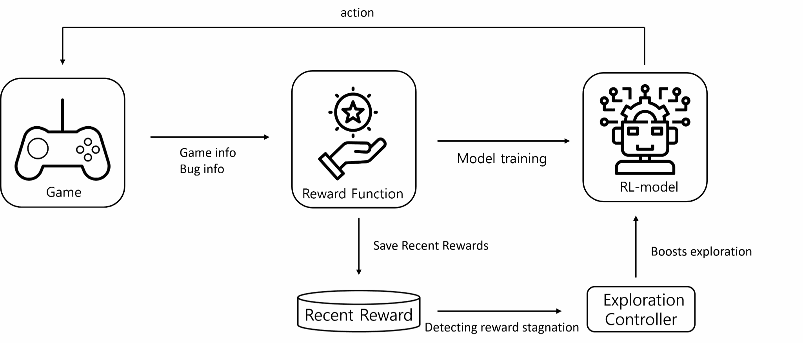
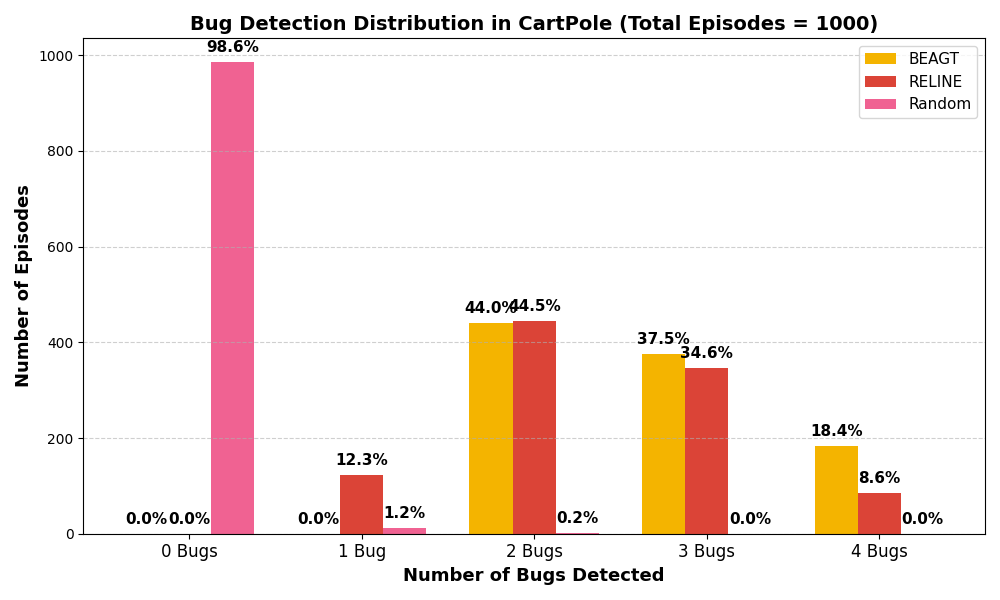
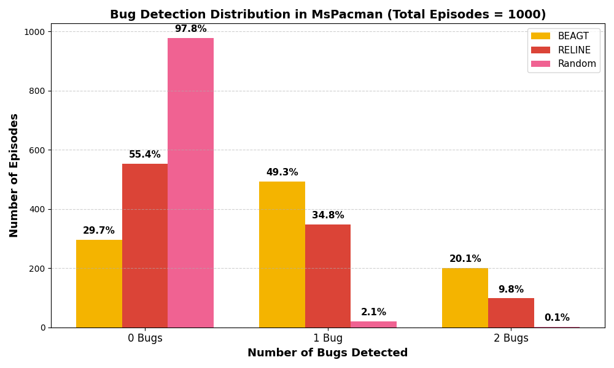

# BEAGT

**Overcoming Exploration Stagnation in Reinforcement Learning-Based Automated Game Testing**

This repository contains research code and experimental figures for **exploration stagnation** in reinforcement-learning-based automated game testing. The work was developed as an initial study of exploration control in relatively simple environments, before extending the research toward coverage-aware exploration in more complex 3D environments.

## Overview

In automated game testing, an RL agent can quickly converge to familiar trajectories and lose exploration capacity. BEAGT addresses this by detecting stagnation from recent reward changes and temporarily increasing the exploration level of the policy.

The study evaluates this approach using DQN-based agents with **ε-greedy** and **softmax exploration**, in CartPole and MsPacman.

## Environments

### CartPole
Location-based fault scenarios are embedded into the environment and evaluated with repeated test episodes.

### MsPacman
The study also evaluates exploration behavior in MsPacman using the RELINE research environment.

Reference environment: https://github.com/RosaliaTufano/rlgameauthors

## Method

BEAGT monitors recent reward progress. When the reward change falls below a stagnation threshold, the exploration parameter is temporarily increased:

- **ε-greedy**: increase ε
- **Softmax exploration**: increase temperature

The goal is not simply to maximize task reward, but to recover exploration when the policy becomes overly concentrated on already-known trajectories.



*BEAGT framework: recent rewards are monitored to detect stagnation, and an exploration controller temporarily increases the exploration parameter.*

## Results

### CartPole



*Distribution of the number of faults found per test episode in CartPole (1,000 test episodes; methods: BEAGT, RELINE, Random).*

### MsPacman



*Distribution of the number of faults found per test episode in MsPacman (1,000 test episodes; methods: BEAGT, RELINE, Random).*

The experiments compare BEAGT with RELINE and a random-action baseline. After training, the learned policies are fixed for repeated evaluation. The study reports an increased number of test episodes in which all designated faults were discovered under the evaluated settings.

## Repository Structure

```text
BEAGT/
├── assets/
│   ├── beagt_framework.png
│   ├── beagt_cartpole_results.png
│   └── beagt_mspacman_results.png
├── CartPole/
│   ├── BEAGT_train.py
│   ├── RELINE_train.py
│   └── best_model/
├── pre-experiment/
│   └── env.py
└── readme.md
```

## Research Contribution

My contribution to this work included:

- constructing location-based fault scenarios for CartPole and MsPacman,
- implementing and evaluating dynamic exploration control with DQN,
- comparing BEAGT with existing and random exploration baselines,
- analyzing fault-discovery behavior after policy training.

## Publication

**Tae-Hyeon Jang**, Yeajin Lee, Hyunseok Kim,  
*Overcoming Exploration Stagnation in Reinforcement Learning-Based Automated Game Testing*,  
Journal of Digital Contents Society, 2025.  
**First Author** · [DOI](https://doi.org/10.9728/dcs.2025.26.7.1801) · [Research portfolio](https://app.notion.com/p/3eb8622d184b81409969edc2455d9ab4)

## Notes

This repository is provided as research code for the published study. Environment dependencies and versions may require adjustment on newer systems.
